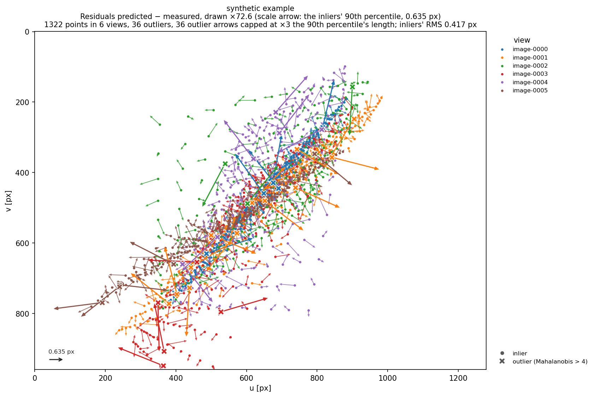
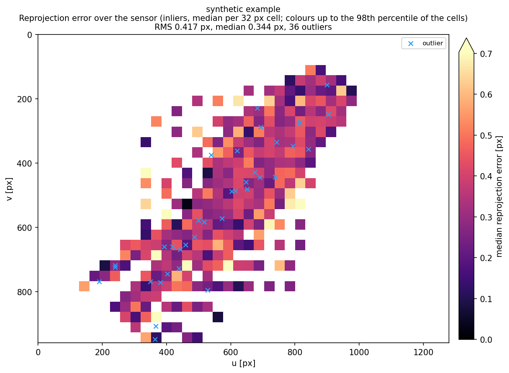

# Re-evaluating a camera

`calibconsumer evaluate` (or `python3 -m calibconsumer evaluate`) measures a camera against measured image points and
their world points. Nothing is optimized: the camera stays as it is, the poses are taken from the inputs, and a view
without a pose gets one estimated from its own points. Use it to check a calibration on new images, compare a
calibration with your own OpenCV or Brown parameters on the same points, or look at where the residuals are
systematic.

## What it computes, per observation

| Error | Meaning | Unit |
|---|---|---|
| reprojection | the world point's predicted pixel minus the measured pixel | px |
| angle | the angle between the measured pixel's ray and the direction from the ray's origin to the world point | arcsec |
| normalized | that angle in pixels (divided by the angle between neighbouring pixels' rays there) – the calibration program's "normalized angular error" × √2, which divides by the diagonal neighbour's angle | px |
| object space | the world point's distance from the measured pixel's ray | world units |

Each observation also gets its **expected σ**:
- in the image: an ellipse (σ_major, σ_minor, angle). It combines the camera's model σ (the calibration's ray σ and
  the mapping's re-fit error, from the camera's `uncertainty`), the world point's covariance propagated to the pixel,
  and the image noise;
- in the world: the σ normal to the ray at the point's distance. It combines the model σ and the image noise times
  that distance and the pixel's angle, and the world point's own σ normal to the ray.

The **Mahalanobis distance** of the reprojection residual under that covariance decides the outliers (default above
4; `--outlier-threshold`). Without a calibration σ (non-central cameras, cameras of your own) the expected σ holds the
known parts and the output says so. The image noise is the camera's (`uncertainty.imageSigmaPx`), the one you give
(`--image-sigma`), or else estimated from the residuals as median |r| / 1.1774. That estimate includes any systematic
misfit, so give `--image-sigma` when you know your detector's noise.

## Inputs

**A calibration's result** – the camera's result folder `resultsCalibration/<run>/cameraLensInstance-<id>`:

```
calibconsumer evaluate resultsCalibration/<run>/cameraLensInstance-1 --out evaluation
```

This takes the camera (`mapping.json`, else `results_OpenCV.json` or `results_BrownCamera.txt`), its calibration
uncertainty (`error-statistics.json`), the views' poses (the camera's `views`), the world the run calibrated with
(`updated-worldPoints.csv` – the optimized world when the world was optimized, else the given one), the world points'
covariances (`refined-target.json`, when the world was optimized) and the measured points of the project the run
names (`cameraLensInstance-<id>/images/<view>.csv`). Every part can be replaced by the options below.

**Your own data** – any combination of:

| Option | File |
|---|---|
| `--camera` | `mapping.json`; OpenCV parameters as JSON (`cameraMatrix`, `distortionCoefficients` (4, 5, 8, 12 or 14), `imageSize` [W, H], optional `rvecs`/`tvecs` per view – or `camera_matrix`, `distortion_coefficients`, `image_width`, `image_height`) or OpenCV's own YAML/XML (`cv2.FileStorage`, as OpenCV's calibration samples write it; needs OpenCV); Brown parameters as `results_BrownCamera.txt` or JSON `{"model": "Brown", "parameters": {"C", "XP", "YP", "K1", "K2", "K3", "P1", "P2", "B1", "B2"} (mm; C positive), "pixelSizeMM": [sx, sy], "resolution": [W, H]}` |
| `--points` | a folder of per-view files `<view>.csv` (rows `id u v`), or one file with rows `view id u v` |
| `--world` | rows `id X Y Z [pattern name]` |
| `--world-sigma` | rows `id σ`, `id σx σy σz` or `id xx xy xz yy yz zz` (a covariance), or a `refined-target.json` |
| `--poses` | JSON `{view: {"rotation": 3 × 3 camera → world, "centre": [x, y, z]}}` (the package's camera frame, as `mapping.json`'s `views`), or `{view: {"rvec", "tvec"}}` / `{"rvecs": {…}, "tvecs": {…}}` (OpenCV's world → camera) |
| `--estimate-poses` | `missing` (default: views without a pose), `all`, `never` |
| `--project`, `--camera-id` | a calibration project (folder or `projectData.json`) as the source of points and world |

Text files may separate columns by spaces, tabs, commas or semicolons; `#` starts a comment, and header rows are
skipped. Pixels: (0, 0) is the centre of the top-left pixel, u to the right, v down, the same as OpenCV's pixel
coordinates. View names are the file names without `.csv`/`.txt` and without a trailing dot. Point ids are compared as
text (`7` and `7.0` are the same id).

Example with OpenCV parameters of your own and no poses:

```
calibconsumer evaluate --camera camera.yml --points points.csv --world target.txt --image-sigma 0.2 --out evaluation
```

## Outputs (in `--out`, default `./evaluation`)

- `evaluation.json` – `format` "calibconsumer-evaluation", `formatVersion` 1: `inputs` (where everything came from),
  `summary` (all observations and per view: counts, outliers, and for each error the RMS, mean, median, 90th percentile
  and maximum over the inliers; the expected σ; the image σ and its source; per view the pose's source), and `poses`
  (every view's pose as used, with its source);
- `observations.csv` – one row per observation: view, id, measured and predicted pixel, the residual, the four errors,
  the distance, the σ ellipse in the image, the σ in the world, the Mahalanobis distance, outlier, valid;
- `residuals.png` – the residuals as arrows from the measured points, exaggerated so that the inliers' 90th
  percentile is about two mean point spacings long. The factor and a scale arrow are given, there is one colour per
  view, and outliers are drawn as crosses on top, with their arrows capped;
- `errorMap.png` – the inliers' median reprojection error per sensor cell, with the outliers marked.

Plots need matplotlib (`pip install calibconsumer[plot]`); `--no-plots` skips them.




*The synthetic example of `examples/reevaluate.py`: six views of a planar target, 0.3 px noise, 3 % gross outliers.*

## From Python

```python
import calibconsumer
from calibconsumer import inputs, plots
from calibconsumer.evaluate import evaluate

camera = calibconsumer.load("camera.json")
views = inputs.read_points_any("points.csv")             # {view: (ids, uv)}
world = inputs.read_world("target.txt")                  # {id: (3,)}
result = evaluate(camera, views, world, poses_given={}, world_covariance=None, image_sigma=0.2)
print(result.summary()["all"]["reprojectionPx"])
result.to_csv("observations.csv")
plots.residuals(result, "residuals.png")
```

`examples/reevaluate.py` shows the per-point σ in the image and in the world, and the same σ straight from
`camera.world_to_pixel(…, return_covariance=True)`.
